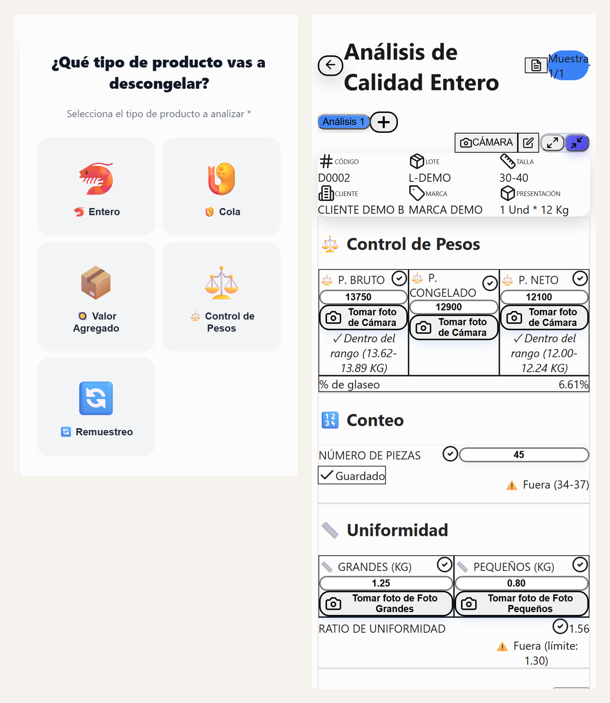

# Análisis de Descongelado · QMS para productos marinos

App web instalable (PWA) que digitaliza el control de calidad de **producto descongelado** en una empacadora de camarón: el analista registra tallas, defectos y pesos, y la app los valida al momento contra la ficha técnica del producto.

La desarrollé en 2025 mientras trabajaba como Monitor de Calidad. **Esta es la versión de portafolio:** las fichas técnicas y los clientes son **ficticios** (4 productos de ejemplo, `D0001`–`D0004`), y no incluye datos, configuración, logos ni cuentas de la empresa.



## Qué hace

- **Varios escenarios de producción**: camarón entero y cola, valor agregado, control de pesos brutos y netos, remuestreo.
- **Validación en tiempo real** contra la ficha técnica: tallas, uniformidad, defectos (límites en % o absolutos), peso neto y glaseo, con alertas visuales.
- **Lectura de fichas en PDF** (`app/api/parse-spec`) para cargar especificaciones nuevas.
- **Evidencia fotográfica**: compresión en el teléfono, cola de subida con reintentos y carpetas automáticas en Google Drive (`/CODIGO/LOTE/TALLA`).
- **Funciona sin conexión** (IndexedDB + Service Worker) y se sincroniza al volver la señal.
- **Reporte diario** y trazabilidad por analista.
- Versión Android empaquetada con Capacitor.

## Tecnología

Next.js · React · TypeScript · Tailwind CSS · Firebase Firestore y Auth · Google Drive API · IndexedDB · Service Worker · Capacitor

## Cómo correrla

```bash
npm install
cp .env.example .env.local   # completa los valores de tu proyecto de Firebase y Google
npm run dev
```

Para verla **sin configurar nada** (con los productos ficticios y sin base de datos):

```bash
NEXT_PUBLIC_DEMO_MODE=1 npm run dev
```

## Seguridad (mejoras de esta versión)

- **Sin claves en el código**: toda la configuración sale de variables de entorno.
- **Reglas de Firestore más estrictas** (`firestore.rules`): antes bastaba con iniciar sesión con cualquier cuenta de Google; ahora además el correo tiene que ser del dominio de la organización.
- **Pendiente para producción**:
  - Las fichas técnicas no deberían ir dentro del código, porque se publican en el JavaScript del sitio. Lo correcto es guardarlas en Firestore y leerlas después de iniciar sesión.
  - Las fotos se comparten en Drive con "cualquiera con el enlace". Conviene limitarlas al dominio de la organización.

## Errores corregidos en esta versión

- La lectura de fichas en PDF no funcionaba en producción: con el export estático la ruta `/api/parse-spec` no se publicaba. Ahora el export estático es opcional (`STATIC_EXPORT=1`).
- La validación de conteo se saltaba los rangos con barra (`91/110`) y mostraba "Límite: NaN-15" con el formato `U-15`. Ahora reconoce `21-25`, `91/110`, `U-15` y `U7`.
- La ruta del PDF aceptaba cualquier archivo: ahora exige un PDF real y de 10 MB como máximo.

---

**Autor: Roger Pillasagua**

- Correo: [rogerpillasagua95@gmail.com](mailto:rogerpillasagua95@gmail.com)
- WhatsApp: [+5999 692-5640](https://wa.me/59996925640)
- [Portafolio](https://rpillasagua95.github.io) · [LinkedIn](https://www.linkedin.com/in/rogerpillasagua)
